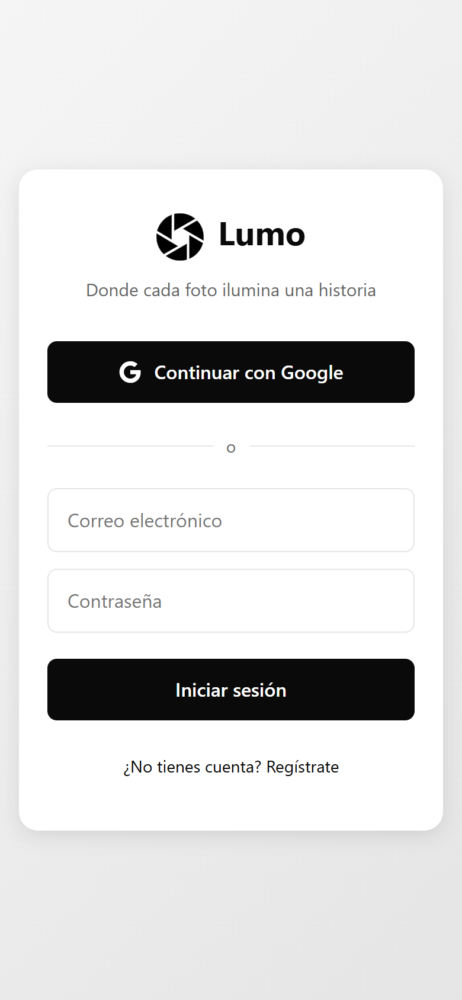
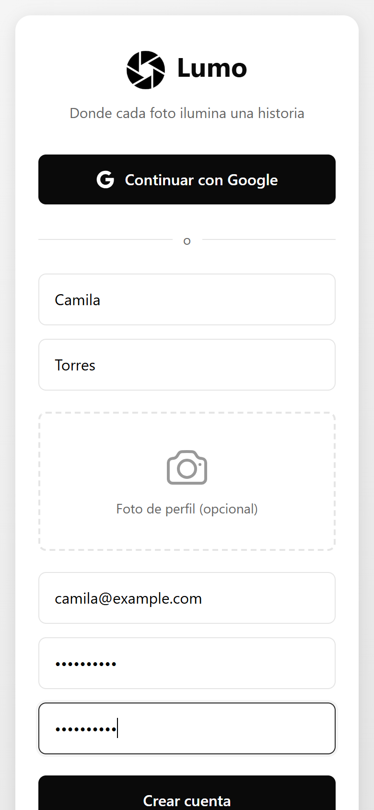
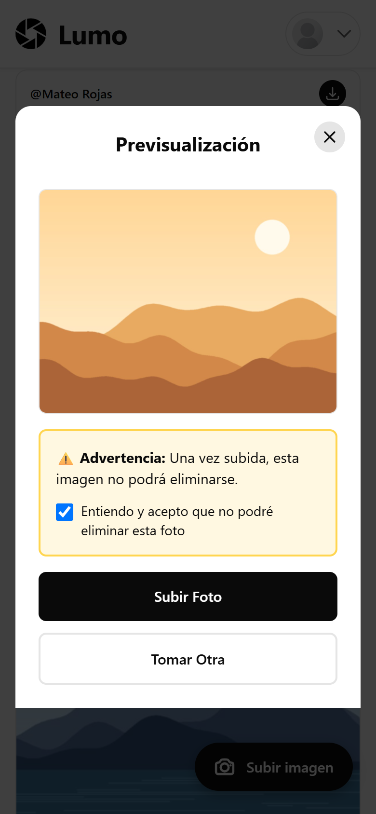
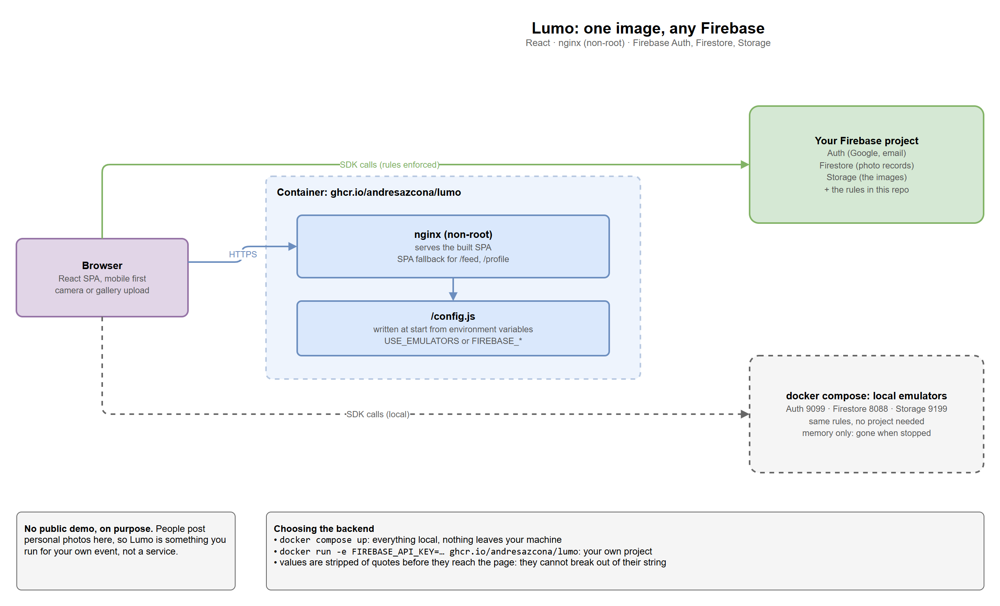
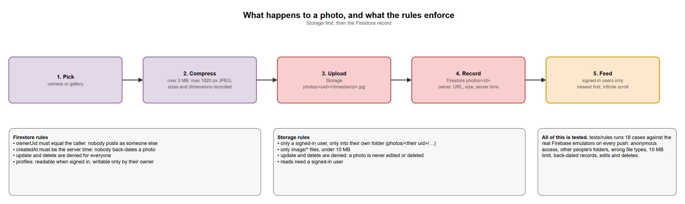

# Lumo

A shared photo album for an event. Everyone signs in, posts photos from their phone, and nobody can delete or edit what was posted. Built with React and Firebase, and packaged so you can run it in one command without a Firebase project.


[](https://github.com/andresazcona/Lumo/actions/workflows/ci.yml)


<p align="center">
  
  
  
  
</p>

> Screenshots use generated placeholder images, not real photos.

> The interface is in Spanish.

## What it does

- **Sign in** with Google or email and password.
- **Post photos** from the phone camera or the gallery. Large images are compressed in the browser (over 3 MB: JPEG, 1920 px at most) before uploading.
- **Browse a feed** of everyone's photos, newest first, with infinite scroll, and **download** any of them.
- **Write once.** A photo can never be edited or deleted, by anyone, including its author. This is enforced by the database rules, not just hidden in the interface.
- **Profile and settings** with a display name and avatar.

## Run it in one command

```bash
docker compose up --build        # http://localhost:3000
```

This starts the app and the Firebase Auth, Firestore and Storage emulators with this repository's security rules. You need no Firebase account, nothing leaves your machine, and **everything is kept in memory**: stop the containers and every account and photo is gone.

## Deploy it for a real event

The image is configured when it starts, so the same image works against any Firebase project:

```bash
docker run -p 8080:8080 \
  -e FIREBASE_API_KEY=... -e FIREBASE_AUTH_DOMAIN=... -e FIREBASE_PROJECT_ID=... \
  -e FIREBASE_STORAGE_BUCKET=... -e FIREBASE_MESSAGING_SENDER_ID=... -e FIREBASE_APP_ID=... \
  ghcr.io/andresazcona/lumo:latest
```

Then publish the rules in this repository to your project (`firebase deploy --only firestore:rules,storage`) and enable the sign-in methods you want in the Firebase console. Without the rules the project's defaults apply, and the privacy guarantees below do not hold.



### Development

```bash
cp .env.example .env             # your Firebase web config
npm install && npm run dev
```

## Privacy model

There is no public demo on purpose: people post personal photos here, so Lumo is meant to be run for your own event.

- Reading photos and profiles requires a signed-in user.
- Uploads go only into your own folder (`photos/<your uid>/`), must be images, and must be under 10 MB.
- A photo record's owner must be the caller and its timestamp must come from the server, so nobody can post as someone else or back-date a photo.
- Photos and their records cannot be deleted, and the rules deny updates to them (`allow update: if false`).

Photos are visible to every signed-in user of that deployment. If you need per-album privacy, the next step is an album document that gates both reads and uploads.



## Tests

```bash
npm test                 # configuration resolution (build env, runtime config, emulators)
npm run test:rules       # 18 security-rules cases against the real emulators (needs Java 17+)
npm run lint && npm run build
```

`test:rules` covers anonymous access, other people's folders, wrong file types, the 10 MB limit, back-dated records, and edits and deletes. CI runs all of it, then builds the image, smoke-tests the container (SPA fallback, runtime config, non-root user, hostile config values) and publishes it to GHCR.

## How it is put together

```
src/lib/         config (where Firebase settings come from), firebase, auth, firestore, storage
src/routes/      Auth, Feed, Profile, Settings
src/components/  CameraModal, PhotoCard, UploadFAB, Header
firestore.rules  storage.rules  firebase.json    the privacy model, tested in tests/rules
docker/          nginx config, the start-up hook that writes /config.js, the emulators image
```

- **One image, any backend.** Settings are resolved at runtime: emulators, then the values written to `/config.js` at container start, then `VITE_FIREBASE_*` from the build. A missing value produces an error that names every missing variable instead of a blank page.
- **Config values cannot break out of their string.** The start-up hook strips quotes and angle brackets before writing them into JavaScript, and CI checks it with a hostile value.
- **nginx runs as a non-root user** and falls back to `index.html` so deep links like `/feed` work.

## Limits and what is next

- Overwriting an existing photo is blocked by the Storage `update` rule, but the Firebase Storage emulator does not model that case, so it is not covered by the automated tests. File names include a timestamp, so the app never overwrites; verify the rule in your own project if it matters to you.
- One shared album per deployment. Multiple albums with invite links would be the natural next step.
- The interface is in Spanish only.
- Photos are not deleted even by the person who posted them. That is the point for an event album, but it means a mistaken upload needs the project owner to remove it from the Firebase console.

## License

MIT
